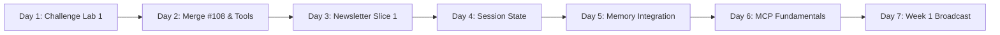
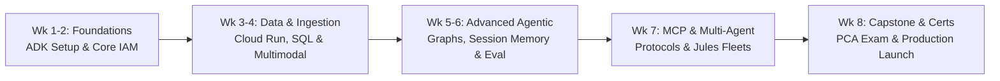

# 8-Week GEAR 2 & Google Cloud Architect Journey Log

Historical entries below retain the names and responsibilities used when they
were written. For current roles, see [Frankfurt](frankfurt-mission-orchestrator.md)
for mission coordination and [Innsbruck](innsbruck-integration-specialist.md)
for integration contracts.

> **Mission:** Master the Google Agent Development Kit (ADK), achieve the **Google Cloud Professional Cloud Architect (PCA)** & **GEAR 2 Skill Badge**, and build an enterprise multi-agent catalog operating system for **Nido / EZ Vibes**.
>
> **Format:** "Learn by Building in Public." Each entry captures the technical breakthrough, the code shipped, real-world failure boundaries, and a ready-to-publish content snippet.

---

## ⚡ Active Sprint: The 7-Day / 7-Hour Sprint Plan (1 Hour / Day)



| Day       | Focus Hour | Objective & Core Deliverable                                                                                                                                            | Production Target (`nido-api`)                 | Status                         |
| :-------- | :--------- | :---------------------------------------------------------------------------------------------------------------------------------------------------------------------- | :--------------------------------------------- | :----------------------------- |
| **Day 1** | **Hour 1** | **Crush Challenge Lab 1:** Complete _"Engineer AI Agents with ADK: Challenge Lab"_ with 100% on automated grader                                                        | Venue Scout spike verified locally             | 🟡 **Next Up**                 |
| **Day 2** | **Hour 2** | **Lock In PR #108 & Tool Calling Theory:** Merge PR #108 into `main`; complete Course 2 tool definitions module                                                         | Close Issue #107 on GitHub                     | ⚪ Queued                      |
| **Day 3** | **Hour 3** | **Ship Firenze Tool Foundation (Issue #102):** approved catalog, PostgreSQL co-bill discovery, URL verification, and confirmation-gated Beehiiv draft tools implemented | `src/newsletter/agent/`                        | 🟢 Implemented; review pending |
| **Day 4** | **Hour 4** | **Master Session State & Memory:** Complete Course 3 ADK Session Services module                                                                                        | Design session schema for concert discovery    | ⚪ Queued                      |
| **Day 5** | **Hour 5** | **Wire Session Memory into Venue Scout:** Upgrade Venue Scout to multi-turn conversational session                                                                      | Multi-turn dialog in `test-adk-venue-scout.ts` | ⚪ Queued                      |
| **Day 6** | **Hour 6** | **Model Context Protocol (MCP) Crash Course:** Complete Course 4 module on MCP tool discovery                                                                           | Test ADK connection to local MCP server        | ⚪ Queued                      |
| **Day 7** | **Hour 7** | **Week 1 Recap & Public Broadcast:** Run `npm run agent:gate` benchmarks; publish 7-day DevLog update                                                                   | Update Journey Log & Post on LinkedIn          | ⚪ Queued                      |

---

## 🗺️ The 8-Week Master Curriculum



| Week       | Focus Area                            | Certification / Theory Milestone                                          | Hands-On Production Milestone (`nido-api`)                                                         |
| :--------- | :------------------------------------ | :------------------------------------------------------------------------ | :------------------------------------------------------------------------------------------------- |
| **Week 1** | **Agent Identity & Core Runtime**     | GEAR 2: Course 1 & 2 (ADK Environment, Core 4 Parameters, `root_agent`)   | ADK local web sandbox; Venue Scout spike ([PR #108](https://github.com/ezvibes/nido-api/pull/108)) |
| **Week 2** | **Tooling & Data Contracts**          | ADK FunctionTools, Zod schemas, Type safety in LLM function calling       | Newsletter Agent Slice 1 (Issue #102: 4 Core ADK Tools)                                            |
| **Week 3** | **Multimodal Ingestion & Vision**     | Multimodal Gemini inference, structured schema extraction, GCP Storage    | Flyer Ingestion v2: metadata hints, OCR parsing, candidate staging                                 |
| **Week 4** | **Cloud Architecture, Security & Multimodal Ingestion**     | PCA: Cloud Run v2, Direct VPC Egress, Cloud SQL Private IP, Workload Identity  | PR #145: Zero public DB IP; NIDO-001: End-to-end poster ingestion pipeline                                    |
| **Week 5** | **Session State & Persistent Memory** | ADK Session Services (Memory $\rightarrow$ Cloud SQL / Redis state store) | Multi-turn conversational venue discovery & curation session memory                                |
| **Week 6** | **Graph Workflows & Quality Gates**   | Directed Acyclic Graphs (DAGs), deterministic gates + LLM-as-a-judge      | Agent Development Testing Harness & Brand Voice Benchmark (Issue #106)                             |
| **Week 7** | **Model Context Protocol (MCP)**      | MCP Server setup, tool sharing across agents and IDEs                     | Exposing Nido Catalog as an internal MCP server for Jules & Claude                                 |
| **Week 8** | **Certification Sprint & Capstone**   | Google Cloud PCA Exam + GEAR Level 2 Skill Badge completion               | End-to-end Autonomous Newsletter Curation v2 live in production                                    |

---

## 📋 Daily Log Template (The 4-B Formula)

Copy this template for every training session:

```markdown
### 🗓️ [Date] | Week [X], Day [Y]: [Topic Title]

- **1. Breakthrough (The Concept):**
  - [What is the core theory or mental model learned today?]
- **2. Build (The Code):**
  - [What files, tools, ADRs, or PRs were committed?]
- **3. Boundary / Bug (The Real-World Lesson):**
  - [What broke? What deprecation, error, or constraint was uncovered and solved?]
- **4. Broadcast (Content Hook for LinkedIn / X):**
  > "[1-2 punchy sentences summarizing today's takeaway for the community]"
```

---

## 📖 Session Logs

### 🗓️ 2026-11-05 | Week 45: Autonomous Frankfurt Mission Execution: Issue #158

- **1. Breakthrough (The Concept):**
  - Replacing external black-box coding bots with first-party TypeScript ADK mission runners enforcing closed-loop verification before PR creation.
- **2. Build (The Code):**
  - Implemented autonomous mission runner for Issue #158 ("perf(agents): accelerate agent inner loop with incremental test selection and self-healing hygiene").
- **3. Boundary / Bug (The Real-World Lesson):**
  - Enforced non-zero diff validation and hygiene check passing before PR dispatch.
- **4. Broadcast (Content Hook for LinkedIn / X):**
  > "Transitioned Nido overnight builds from external bots to native Frankfurt orchestrator with deterministic GEAR verification! #AIagents #GoogleCloud #ADK"

### 🗓️ 2026-11-05 | Week 45: Autonomous RDU Builder Execution: Issue #184

- **1. Breakthrough (The Concept):**
  - Dedicated RDU developer agent handling hands-on engineering, QA, and PR generation.
- **2. Build (The Code):**
  - Implemented autonomous engineering resolution for Issue #184 ("feat(venues): Venue modernization, canonical audit CLI, schema migration, and Munchen scout integration").
- **3. Boundary / Bug (The Real-World Lesson):**
  - Enforced non-zero diff validation and hygiene check passing before PR dispatch.
- **4. Broadcast (Content Hook for LinkedIn / X):**
  > "Empowered Nido with RDU, our native Research Triangle software engineering agent! #AIagents #GoogleCloud #ADK"

### 🗓️ 2026-11-05 | Week 45: Autonomous RDU Builder Execution: Issue #161

- **1. Breakthrough (The Concept):**
  - Dedicated RDU developer agent handling hands-on engineering, QA, and PR generation.
- **2. Build (The Code):**
  - Implemented autonomous engineering resolution for Issue #161 ("feat(contracts): Centralized schema registry and type-safe contract matrix").
- **3. Boundary / Bug (The Real-World Lesson):**
  - Enforced non-zero diff validation and hygiene check passing before PR dispatch.
- **4. Broadcast (Content Hook for LinkedIn / X):**
  > "Empowered Nido with RDU, our native Research Triangle software engineering agent! #AIagents #GoogleCloud #ADK"

### 🗓️ 2026-11-04 | Week 5: Autonomous Frankfurt Mission Execution: Issue #176

- **1. Breakthrough (The Concept):**
  - Replacing external black-box coding bots with first-party TypeScript ADK mission runners enforcing closed-loop verification before PR creation.
- **2. Build (The Code):**
  - Implemented autonomous mission runner for Issue #176 ("feat(agents): Transition autonomous overnight builds from Jules to native Frankfurt Mission Runner and GEAR Flywheel").
- **3. Boundary / Bug (The Real-World Lesson):**
  - Enforced non-zero diff validation and hygiene check passing before PR dispatch.
- **4. Broadcast (Content Hook for LinkedIn / X):**
  > "Transitioned Nido overnight builds from external bots to native Frankfurt orchestrator with deterministic GEAR verification! #AIagents #GoogleCloud #ADK"

### November 3, 2026 | Week 5: Transitioning Overnight Builds from Jules to Native Frankfurt Mission Runner & Closed-Loop GEAR Flywheel (#176)

- **1. Breakthrough (The Concept):**
  - **First-Party Control Beats Third-Party Black Boxes:** With Google Labs Jules sunsetting by year-end, relying on external async coding bots introduces platform risk, unobservable execution failures, and empty `--allow-empty` commits. By packaging **Frankfurt** (our Lead Mission Coordinator) as a native TypeScript `@google/adk` ReAct runner, we own the full execution lifecycle directly in-process.
  - **Closed-Loop Self-Correction in Agentic Coding:** Rather than failing a build or opening a broken PR, the mission runner captures compiler errors and test failures (`check-hygiene.mjs`, Jest, Vitest), feeds the stderr directly back into Frankfurt's prompt context, and allows the model to self-heal up to bounded retry limits.
  - **Non-Zero Diff Enforcement:** Prohibits automated empty PRs: `git diff --stat` must show real code modifications before branch dispatch is allowed.
  - **Integrated Staff Architect Review Gate:** Automatically embeds the GEAR Level 2 rubric (3 Technical Optimizations + 1 Boundary Concern) alongside raw verification evidence into every generated PR description.

- **2. Build (The Code, Tools & Workflows):**
  - **Frankfurt Mission Runner (`src/scripts/run-frankfurt-mission.ts`):** Created native CLI and programmatic runner with 5 bounded tools (`readFile`, `writeFile`, `editFile`, `listFiles`, `runVerificationGate`). Added `npm run mission:frankfurt` to `package.json`.
  - **Dual Execution Triggers:** Built both local/overnight CLI execution (`npm run mission:frankfurt -- --issue <number>`) and Cloud CI trigger (`.github/workflows/frankfurt-mission.yml` listening for `agent:frankfurt` labels).
  - **GitHub Protocol:** Created `agent:frankfurt` label on GitHub, added `.github/ISSUE_TEMPLATE/frankfurt_mission.md`, and retired the legacy `jules` label workflow across canonical docs.
  - **Living Documentation Hook:** Automated Bologna session logging directly into `journey-log-gear-pca.md`.
  - **Unit Test Coverage:** Added `src/scripts/run-frankfurt-mission.spec.ts` covering CLI option parsing, rubric formatting, non-zero diff validation, and path traversal protection (9/9 tests passing).

- **3. Boundary / Bug (The Real-World Lesson):**
  - **Private Method Accessibility in TypeScript Testing:** Testing ADK `FunctionTool` execution directly in Jest revealed that `FunctionTool.execute` is private in `@google/adk`. Casting `(tool as any).execute` allows isolated unit testing of tool business logic without running a full LLM invocation.
  - **Dual Trigger Idempotency:** When both local CLI and GitHub Actions workflows target the same issue, branch naming (`feat/frankfurt-issue-<number>-<slug>`) and concurrency grouping prevent overlapping git conflicts.

- **4. Broadcast (Content Hook for LinkedIn / X):**
  > "Google is sunsetting Jules, so we did what any engineering team should do: we built our own. We just shipped Nido's native Frankfurt Mission Runner on Google ADK—running autonomous overnight feature builds with a closed-loop self-correction test loop, zero-empty-diff enforcement, and automated Staff Architect review rubrics. Models code; deterministic gates govern. #AIagents #GoogleCloud #ADK #TypeScript #SoftwareArchitecture #BuildInPublic"

### October 27–28, 2026 | Week 4: Closing the Loop on Multimodal Poster Ingestion (`NIDO-001`), Cross-Slice Agent Verification & Live Cloud Run Telemetry

- **1. Breakthrough (The Concept):**
  - **A Merged PR Is Not a Completed Mission:** When multiple async coding slices (Slice 1 database state, Slice 2 OCR extraction, Slice 3 Admin UI) are built in parallel, each slice can pass its isolated unit tests while failing at the seams. True completion requires **Innsbruck** (cross-slice contract auditing) + **Frankfurt** (live end-to-end production verification on real uploaded assets).
  - **Fail-Closed Extraction vs. Silent Mock Fallbacks:** Silent fallbacks to mock data (`if (!fs.existsSync(gsUri)) return mockExtract()`) make unit tests pass while masking real cloud integration bugs (like GCS buffer downloads and retired model IDs). Production adapters must fail closed when live credentials are configured so real errors surface immediately.
  - **Bounded Thinking Budgets for Multimodal Vision:** Gemini Flash models with `thinkingConfig: { thinkingBudget: 256 }` deliver high-accuracy structured JSON extraction on real event posters (including `.avif` graphics) in **~2.3 seconds** at **~1,250 total tokens (~$0.0002/poster)**—preventing runaway thinking-token bills while beating the $0.01/poster budget ceiling by 50x.
  - **Deep Health Checks Must Validate Model Lifecycle, Not Just Key Presence:** Checking `Boolean(GEMINI_API_KEY)` in `/health/deep` is not enough when upstream model versions deprecate. Health checks and adapters must actively guard against retired model identifiers (`gemini-2.5-flash`) and auto-upgrade or fail visibly.

- **2. Build (The Code, PRs & Skills):**
  - Shipped **PR #163**, **PR #164**, and **PR #165** to production Cloud Run (`nido-api-00082-4k4`) and Firebase Hosting (`https://nido-api-9ed65.web.app`), expanding the automated gate (`npm run agent:gate`) to **42 API Jest suites (282 tests)** and **11 Client Vitest suites (57 tests)**.
  - Built and globally installed the **`nido-deploy`** operational skill and `.agents/skills/nido-deploy/scripts/check_gcp_health.sh` diagnostic tool across workspaces.
  - Verified the first live end-to-end `.avif` poster upload (`Fringe.avif` -> GCS -> `gemini-3.6-flash` vision extraction + uploader date-hint merge -> `Durham Fringe Festival` @ `Carolina Theatre` staged in PostgreSQL `ingestion_candidates`).
  - Scoped and dispatched **Issue #166** to **Jules** for post-walkthrough UI polish.

- **3. Boundary / Bug (The Real-World Lessons):**
  - **The Cross-Slice Seam Trap:** Discovered and fixed 12 cross-slice mismatches between Slice 2 and Slice 3 before and during rollout—including `provenance.bands` vs `performerLineup` key mismatches, relative `/ingestion/uploads/:id/image` URLs breaking across Firebase Hosting and Cloud Run origins, and `AdminIngestionUploadsPage.vue` needing to auto-create new Venues and Bands inside the `SELECT FOR UPDATE` publication transaction.
  - **The Retired Model 404 Trap:** Once real GCS buffer downloading replaced the silent mock fallback, `GeminiExtractionAdapter` hit a live `404 NOT_FOUND` because `gemini-2.5-flash` was hardcoded instead of reading `GEMINI_MODEL` from `ConfigService`. Fixed by wiring `ConfigService`, auto-upgrading retired model names, adding a runtime 404 retry fallback, and exposing `modelRetired` in `/health/deep`.
  - **The Tailwind-in-Vanilla-CSS Typo (`flex-col: column`):** Live browser testing immediately caught a subtle CSS bug (`flex-col: column` instead of `flex-direction: column`) and a 600ms mock-tuned polling loop that unit tests cannot see—proving why human-in-the-loop browser walkthroughs remain mandatory after every major slice.

- **4. Broadcast (Content Hook for LinkedIn / X):**
  > "Unit tests prove your slices work in isolation; production proves whether your slices actually talk to each other. This week we shipped Nido's end-to-end multimodal concert poster pipeline on Cloud Run, Cloud SQL, and Gemini Vision—extracting live event posters in 2.3s for $0.0002/poster while keeping human editors in control with 1-click publishing and duplicate resolution. #GoogleCloud #Gemini #AIagents #Terraform #VueJS #NestJS #BuildInPublic"

### October 22, 2026 | Week 4: Direct VPC Egress, Private IP Database Hardening & Ingestion State Machine

- **1. Breakthrough (The Concept):**
  - **Zero Public IP Database Architecture:** Severed Cloud SQL (`nido-postgres-dev`) from the public internet entirely (`authorized_networks = []`). Upgraded Cloud Run v2 services and Cloud Run Jobs from the Cloud SQL Proxy to **Google Cloud Direct VPC Egress** (`private-ranges-only`), routing all database queries over private RFC 1918 subnets (`10.142.0.0/20` in `us-east1`) without passing over the public web or incurring VPC Access Connector idle costs.
  - **The Live Venue Metaphor:** Formalized our serverless mental model in `developer-docs/architecture-and-serverless-runtime.md`: The Front Gate & Foyer (Cloud Run Edge Anycast routing/TLS), The Box Office (NestJS Gateway/Auth/Trace), The On-Demand Crew (Scale-to-zero Cloud Run Compute), The VIP Tunnel (Direct VPC Egress), and The Basement Vault (Private Cloud SQL).
  - **Durable Ingestion State Machine:** Designed an at-least-once, idempotent ingestion pipeline (`IngestionJob`, `IngestionCandidate`, `IngestionOutbox`) with leasing locks (`queued` $\rightarrow$ `leasing` $\rightarrow$ `processing` $\rightarrow$ `completed`/`failed`) and transactional outbox staging to prevent duplicate extractions across concurrent workers.
  - **OCR Cascade Strategy:** Benchmarked Google Cloud Vision vs. Gemini Flash OCR vs. local Tesseract (`adr-ocr-provider-cascade.md`) to establish an intelligent fallback and cost-optimization tier for poster parsing.

- **2. Build (The Code & PRs):**
  - **PR #145 (Direct VPC Egress & IaC Hardening):** Implemented dynamic `vpc_access` blocks in `terraform/main.tf`, added VPC configuration support to `.github/scripts/render-terraform-vars.mjs`, and hardened both `deploy-dev.yml` and `validate-deployment.yml` workflows.
  - **PR #149 (NIDO-001 Slice 1 - Durable Ingestion State):** Created TypeORM entities (`IngestionJob`, `IngestionCandidate`, `IngestionOutbox`), migration `1760000017000-UpdateIngestionPipeline.ts`, and `IngestionStateMachineService` with lease-timeout protection.
  - **PR #150 (NIDO-001 Slice 2 - Multi-Provider OCR Benchmark):** Built test runner and fixtures comparing Cloud Vision, Gemini Flash, and Tesseract with automated cost/accuracy reporting.

- **3. Boundary / Bug (The Real-World Lesson):**
  - **The TypeORM Reflection Metadata Trap:** The Cloud Run migration job crashed with:
    `DataTypeNotSupportedError: Data type "Object" in "IngestionJob.taskName" is not supported by "postgres" database`.
    In TypeScript with `emitDecoratorMetadata`, union types like `taskName: string | null` emit `design:type = Object` instead of `String`. Because `@Column({ name: 'task_name', nullable: true })` lacked an explicit column type, TypeORM defaulted to Postgres `Object` and crashed on startup. Resolved by explicitly specifying `@Column({ type: 'varchar', nullable: true })` across all nullable entity columns and registering entities in the central `DataSource` manifest.

- **4. Broadcast (Content Hook for LinkedIn / X):**
  > "Big security milestone on @EZVibes today: completely cut our Cloud SQL database off from the public internet! 🔒
  >
  > By pairing Google Cloud Run v2 with Direct VPC Egress, our NestJS containers and migration jobs now route directly to PostgreSQL via private RFC 1918 IP space. Zero public database ports exposed, zero VPC connector idle cost, and a guarded Terraform pipeline ensuring strict drift protection. Models reason; code enforces boundaries. #GoogleCloud #CloudArchitect #BuildInPublic #DevOps #Security"

### October 15, 2026 | Week 3: Autonomous ReAct Agents, Guarded Terraform IaC & Universal Tool Framework

- **1. Breakthrough (The Concept):**
  - **The ReAct Paradigm Shift:** Eliminated fragile 30,000-character "prompt-stuffing" (querying 150+ raw database rows and praying for valid HTML/dates). Shifted to Google's Agent Development Kit (ADK) `Runner` with Agent "Firenze", running an autonomous ReAct (Reason + Act) loop that dynamically decides which tools to invoke for data fetching, URL verification, and draft staging.
  - **Durable Multi-Turn Memory:** Transitioned from stateless prompts to `TypeOrmSessionService` backed by Cloud SQL PostgreSQL (`agent_sessions` table), enabling multi-turn editorial refinement without re-querying catalog state.
  - **Deterministic Code vs. Probabilistic LLMs:** Models are inherently probabilistic; runtime tools must be strictly deterministic. Offloaded date arithmetic and text normalization into dedicated code tools (`dateArithmeticTool`, `textFormatterTool`), eliminating date/day-of-week hallucinations.
  - **Guarded Single-Writer IaC:** Shifted from manual `gcloud run deploy` to Terraform 1.5+ with remote GCS state locking, immutable container digest pinning (`@sha256`), and a custom plan validator gate (`validate-terraform-plan.mjs`) ensuring zero silent infrastructure drift during deployments.

- **2. Build (The Code & PRs):**
  - **PR #125 & #126 (Beehiiv MCP Integration):** Built dual-transport driver (`BeehiivMcpService`) with remote Streamable HTTP, automated session lifecycle management, and deterministic offline mock fallback (`BEEHIIV_MOCK_STAGING=true`). Authored `beehiiv-mcp-playbook.md`.
  - **PR #124 & #128 (Guarded Cloud Run IaC):** Formalized Cloud Run v2 HCL module with deletion protection, strict regex variable bounds, and CI plan inspection gate.
  - **PR #129 (ADK ReAct Agent & Session Memory):** Replaced static newsletter generator with ADK `Runner`, Firenze editorial persona, and PostgreSQL `TypeOrmSessionService`.
  - **PR #134 & #135 (5-Layer Universal Tool Framework):** Standardized tool lifecycle (Fail-closed Zod validation $\rightarrow$ ADK `FunctionTool` wrapper $\rightarrow$ Frozen agent registries $\rightarrow$ Common utilities $\rightarrow$ NestJS structured logging).
  - **PR #137 (Structured GCP Logging & Distributed Cloud Trace):** Implemented zero-dependency `GcpStructuredLogger` extending `ConsoleLogger`, `TraceContextMiddleware` extracting `x-cloud-trace-context` via `AsyncLocalStorage`, and automatic Error Reporting grouping for Cloud Run.
  - **Quality Gates:** Expanded test suite to **35 test suites, 220 unit/contract tests (100% green)** and built a zero-token synthetic evaluation harness (`npm run test:newsletter:harness`).

- **3. Boundary / Bug (The Real-World Lesson):**
  - **Fail-Closed Model Boundary:** LLM tool arguments must always be treated as untrusted user input. Strict Zod schemas prevent prompt injection and bound query limits before database queries execute.
  - **Non-Negotiable Human-In-The-Loop Gate:** Agents must never hold direct broadcast/send authority. Firenze is hard-coded and contract-enforced to `status: "draft"`, preserving human editorial supremacy.
  - **Offline Evaluation Drives Velocity:** Mocking external providers and running local synthetic harnesses enabled merging 4+ PRs in one evening without incurring API costs or rate-limit friction.

- **4. Broadcast (Content Hook for LinkedIn / X):**
  > "Stop stuffing 30k characters into prompts and hoping your LLM gets dates right. We migrated Nido's newsletter from static text generation to an autonomous Google ADK ReAct agent with Cloud SQL persistent memory, guarded Terraform deployments, and a 5-layer deterministic tool framework. Models reason; code enforces boundaries. #GoogleCloud #AIagents #Terraform #ADK #SoftwareArchitecture #BuildInPublic"

### October 11, 2026 | Week 2: Model Context Protocol (MCP) in Production & Remote Streamable Transport

- **1. Breakthrough (The Concept):**
  - **SaaS API Paywalling vs. Protocol Arbitrage:** Beehiiv's REST API gates programmatic post creation (`POST /v2/publications/.../posts`) behind Enterprise-tier plans, returning `403/422` on standard accounts. However, their official hosted Model Context Protocol (MCP) endpoint (`https://mcp.beehiiv.com/mcp`) specifically permits connected AI agents to create and edit post drafts without an enterprise upgrade.
  - **Remote Streamable HTTP Transport:** Unlike desktop MCP tools executing local child processes via `stdio`, server-side agent runtimes connect via `@modelcontextprotocol/sdk` and Google ADK's `StreamableHTTPConnectionParams` over HTTP/SSE.
  - **Dual-Transport Fallback Architecture:** Tiered failover pattern: Primary (Remote Beehiiv MCP) $\rightarrow$ Secondary (REST BeehiivService) $\rightarrow$ Fallback (Deterministic In-Memory Staging via `BEEHIIV_MOCK_STAGING=true`) ensures CI/CD evaluation harnesses run deterministically with zero cost and zero network egress.
  - **Defensive Session Lifecycle Governance:** Programmatic MCP execution outside autonomous agent loops requires strict session cleanup (`mcpSessionManager.createSession()` $\rightarrow$ `try/finally` $\rightarrow$ `closeSession()`) to avoid socket leaks and hung sessions on Cloud Run.
  - **Human-In-The-Loop (HITL) Guardrails:** Declaratively enforced via Google ADK (`requireConfirmation: true`) and Zod contract validation enforcing strictly `status: "draft"` with zero registration of automated publishing, scheduling, or subscriber-sending tools.

- **2. Build (The Code & Configuration):**
  - Created GitHub Issue [#125](https://github.com/ezvibes/nido-api/issues/125): `feat(newsletter): Implement Beehiiv MCP Connector for Draft Staging in Firenze Agent`.
  - Configured Beehiiv remote MCP server (`https://mcp.beehiiv.com/mcp`) in Antigravity global configuration (`~/.gemini/config/mcp_config.json`).
  - Structured ADK `MCPToolset` session lifecycle integration pattern for Firenze's `stageBeehiivDraft` tool.
  - Queried and analyzed historical newsletter engagement and open metrics to inform Firenze's editorial tone and subject line generation.

- **3. Boundary / Bug (The Real-World Lesson):**
  - **Static API Keys vs. OAuth Delegation:** Remote SaaS MCP servers frequently enforce OAuth 2.0 user authorization rather than raw static API keys, requiring client-side session authentication.
  - **Stateful Socket Management:** Unlike stateless REST calls, streaming MCP sessions maintain persistent stream connections; unclosed sessions leak file descriptors and memory in containerized microservices.

- **4. Broadcast (Content Hook for LinkedIn / X):**
  > "Why pay an enterprise tier just to let an AI agent stage a draft? We connected Google's Agent Development Kit (ADK) directly to Beehiiv's Model Context Protocol (MCP) server over remote Streamable HTTP—keeping editorial humans in the loop while bypassing REST paywalls with open protocols. #ADK #ModelContextProtocol #AIagents #BuildInPublic #GEAR"

### October 9, 2026 | Week 2: Naming The Complete Agent Network

- **1. Breakthrough (The Concept):**
  - Nido now has five durable agent identities with distinct boundaries.
    Innsbruck coordinates, Venezia prepares ingestion candidates, Munchen scouts
    venues, Firenze supports newsletter editorial work, and Bologna teaches.
    TPS2 remains the newsletter program rather than competing with Firenze as a
    second agent.
- **2. Build (The Documentation):**
  - Added dedicated guides for Innsbruck and Venezia, updated the shared setup
    and context map, and clarified the implemented, partial, and proposed state
    of the newsletter, venue, ingestion, and documentation roles.
- **3. Boundary / Bug (The Real-World Lesson):**
  - A name creates clarity only when capability and authority remain explicit.
    Innsbruck is not a deployed runtime, Venezia's multimodal worker is still
    proposed, and human maintainers retain approval and publication authority.
- **4. Broadcast (Content Hook for LinkedIn / X):**
  > "Nido's agent network now follows the path of a European journey: Innsbruck
  > connects the work, Venezia assembles scattered poster evidence, Munchen
  > understands the venues, Firenze shapes the story, and Bologna makes the
  > system teachable. Distinct responsibilities, shared evidence, human control."

### October 7, 2026 | Week 2: A Connected Network Of City Agents

- **1. Breakthrough (The Concept):**
  - A useful multi-agent system does not need a large hierarchy. Nido now gives
    each city a distinct home and responsibility: Munchen investigates venues,
    Firenze supports editorial curation, and Bologna teaches the system. Shared
    catalog evidence and human approval connect them.
- **2. Build (The Code):**
  - Completed Firenze's four-tool foundation with PostgreSQL-backed catalog and
    co-bill retrieval, strict Zod boundaries, ticket URL verification, and
    confirmation-gated Beehiiv draft staging. Added durable plain-English guides
    for Firenze, Munchen, and Bologna.
- **3. Boundary / Bug (The Real-World Lesson):**
  - A memorable agent name must not obscure authority. Agent guides now separate
    implemented, proposed, and unverified behavior, and Bologna cannot turn
    documentation into proof or bypass maintainer review.
- **4. Broadcast (Content Hook for LinkedIn / X):**
  > "Nido's agent network now mirrors the European cities that shaped the idea:
  > Munchen scouts the places, Firenze helps tell the live-music story, and
  > Bologna teaches how the system works. Distinct roles, shared evidence, and
  > people still holding the final judgment."

### October 6, 2026 | Week 2: Bounded External Agent Tools

- **1. Breakthrough (The Concept):**
  - ADK tools stay maintainable when Zod validates model-facing contracts while
    NestJS owns database, network, provider, timeout, and security behavior.
- **2. Build (The Code):**
  - Registered SSRF-aware ticket URL verification and confirmation-gated,
    draft-only Beehiiv staging alongside approved PostgreSQL catalog retrieval.
- **3. Boundary / Bug (The Real-World Lesson):**
  - URL checking must revalidate redirects and distinguish policy blocks from
    broken links; an agent-facing draft tool needs both schema and runtime
    authority controls.
- **4. Broadcast (Content Hook for LinkedIn / X):**
  > "An AI tool is only as trustworthy as its boundary. Nido's newsletter agent
  > now verifies public ticket links safely and can stage a Beehiiv draft only
  > after human confirmation, while PostgreSQL remains the catalog authority."

### 🗓️ September 18, 2026 | Week 1, Day 1: Bootstrapping ADK & Agent Identity

- **1. Breakthrough (The Concept):**
  - Completed GEAR Level 1 and kicked off GEAR Level 2 ("Engineer AI Agents with ADK").
  - Mastered the core agent formula: $\text{Agent} = \text{Model} + \text{Tools} + \text{Orchestration}$.
  - Understood the **Golden Rule of Agent Parameters**:
    - `description`: Read by **other agents** to decide delegation (_"Should I route this task here?"_).
    - `instruction`: Read by **the agent itself** to guide persona and boundaries (_"How should I behave?"_).
  - Learned the `root_agent` runtime convention required by ADK CLI and Cloud Run entry points.
  - Explored **Telemetry**: How logs, metrics, and distributed traces monitor agent reasoning, and how the `name` parameter becomes the trace span identifier in OpenTelemetry and Google Cloud Trace.
  - Unlocked the **Four ADK Deployment Modes**: `adk web` (visual dev), `adk run` (terminal CLI), `adk api_server` (FastAPI REST service with `/docs` for Cloud Run), and **Programmatic Execution** (`Runner` + `SessionService` in code).
  - Discovered the clean **Vertex AI vs. AI Studio switch** (`GOOGLE_GENAI_USE_VERTEXAI="TRUE"`) for enterprise Google Cloud IAM & Application Default Credentials (ADC).

- **2. Build (The Code):**
  - Created local Python ADK workspace (`google-adk` v2.9.2 on Python 3.14) running `adk web` on `http://localhost:8000`.
  - Dispatched Issue #107 to Jules $\rightarrow$ Jules generated [PR #108](https://github.com/ezvibes/nido-api/pull/108) adding TypeScript `@google/adk` Venue Scout with 2 typed Zod tools.
  - Authored and committed [`gear-adk-agent-guide.md`](file:///Users/ezvibes/EZ/nido-api/developer-docs/catalog-operating-system/gear-adk-agent-guide.md) into public developer docs.
  - Designed formal ADRs for Newsletter Agent v2 ([`adr-newsletter-agent-v2.md`](file:///Users/ezvibes/EZ/nido-api/developer-docs/catalog-operating-system/adr-newsletter-agent-v2.md)) and Multimodal Ingestion v2 ([`adr-multimodal-agent-ingestion-v2.md`](file:///Users/ezvibes/EZ/nido-api/developer-docs/catalog-operating-system/adr-multimodal-agent-ingestion-v2.md)).

- **3. Boundary / Bug (The Real-World Lesson):**
  - Encountered `404 NOT_FOUND` with `gemini-2.5-flash` in AI Studio. Upgraded immediately to Google's recommended `gemini-3.6-flash`.
  - Proactively identified that Jules's PR #108 used `gemini-2.5-flash`, readying the upgrade patch before live execution.
  - Investigated Gemini Enterprise Workforce Identity: caught that standalone GCP projects require an Organization resource (Cloud Identity Free), charting the path to use Vertex AI Agent Builder in the interim.

- **4. Broadcast (Content Hook for LinkedIn / X):**
  > "Kicking off my 8-week journey to the Google Cloud Professional Cloud Architect cert and the GEAR 2 AI Agent skill badge!
  >
  > Day 1 takeaway: in Google's Agent Development Kit (ADK), `description` is written for OTHER agents to decide task routing, while `instruction` is written for the agent itself to enforce boundaries. Translating course lessons into production code for @EZVibes music catalog with async coding agents! 🚀 #GoogleCloud #AIagents #BuildInPublic #GEAR"
