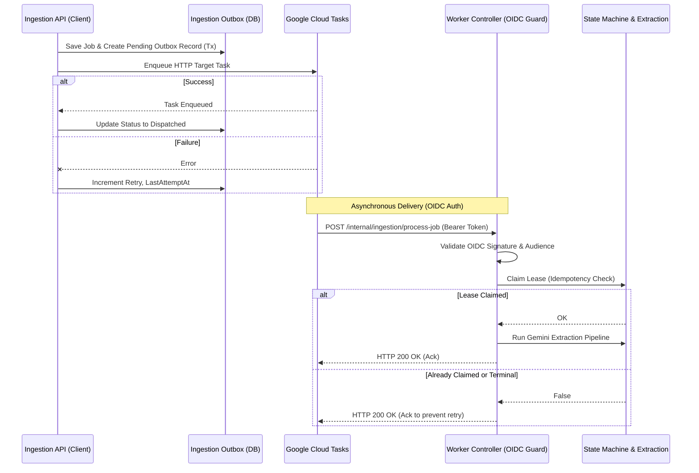

# Worker Queue Architecture (Bologna Guide)

This guide documents the ingestion worker queue architecture for handling durable, asynchronous operations in Nido.

## Architecture

Nido uses an asynchronous, scale-to-zero queue pattern driven by **Google Cloud Tasks** to extract processing (like multimodal OCR and extraction) out of the main request-response API path.

## IAM & Least Privilege Matrix

The system enforces strict boundaries:

1. **Dispatcher Identity (`CLOUD_TASKS_INVOKER_SA`)**:
   - Must hold `roles/cloudtasks.enqueuer` to enqueue tasks to the queue.
2. **Cloud Tasks Invocation Identity (`CLOUD_TASKS_INVOKER_SA`)**:
   - Attached to the Cloud Task `oidcToken`. The target Cloud Run service must grant this identity `roles/run.invoker`.
3. **Worker Identity (Cloud Run Runtime SA)**:
   - Holds access to the Nido Cloud SQL database, Secret Manager, and GCS buckets for document retrieval.
   - *Cannot* arbitrarily enqueue tasks (unless explicitly granted enqueuer roles).

## Queue Configuration Defaults

We recommend configuring the Cloud Tasks queue with the following bounded defaults for safe, resilient throughput (aligned with Issue #62):

- **Max Dispatch Rate:** 1 dispatch/sec.
- **Max Concurrent Tasks:** 2.
- **Max Attempts:** 5.
- **Exponential Backoff:** Min backoff 2s, Max backoff 300s, Doubling multiplier.

## Runbook & Operational Recovery

### Pausing & Resuming the Queue
Use the `gcloud` CLI to pause the queue if workers are failing globally:
`gcloud tasks queues pause [QUEUE_NAME] --location [LOCATION]`
`gcloud tasks queues resume [QUEUE_NAME] --location [LOCATION]`

### Recovering Stranded Outbox Jobs & Redrive
If a transient network error prevents the API from creating the Cloud Task, the `IngestionOutbox` record will remain in the `pending` state. The system provides an automated redrive mechanism:
1. `IngestionTasksDispatcherService.redrivePendingOutbox(limit)` scans pending outbox records and attempts re-dispatch.
2. An authorized operator or Cloud Scheduler job can trigger `POST /internal/ingestion/redrive-outbox`.
3. In-process synchronous fallback: If `INGESTION_ASYNC_DISPATCH_ENABLED=false` or unconfigured, `IngestionService.createJob` immediately falls back to in-process extraction so jobs are never queued indefinitely when worker infrastructure is not active.

### Replay Procedures
Because Cloud Tasks HTTP requests are idempotent based on the `jobId` and lease status, an operator can safely hit the private `/internal/ingestion/process-job` endpoint manually (with an appropriate token), or forcefully reset the job stage in the `IngestionJob` table and enqueue a new task. The deterministic Cloud Task naming (`job-{jobId}`) avoids queue-level duplication for the same job.

### Rollback Checklist
1. Revert deployment (disable Cloud Run routing to new revision).
2. Set `INGESTION_ASYNC_DISPATCH_ENABLED=false`.
3. (Optional) Run an SQL script to process stranded outbox messages synchronously if a hotfix is delayed.
